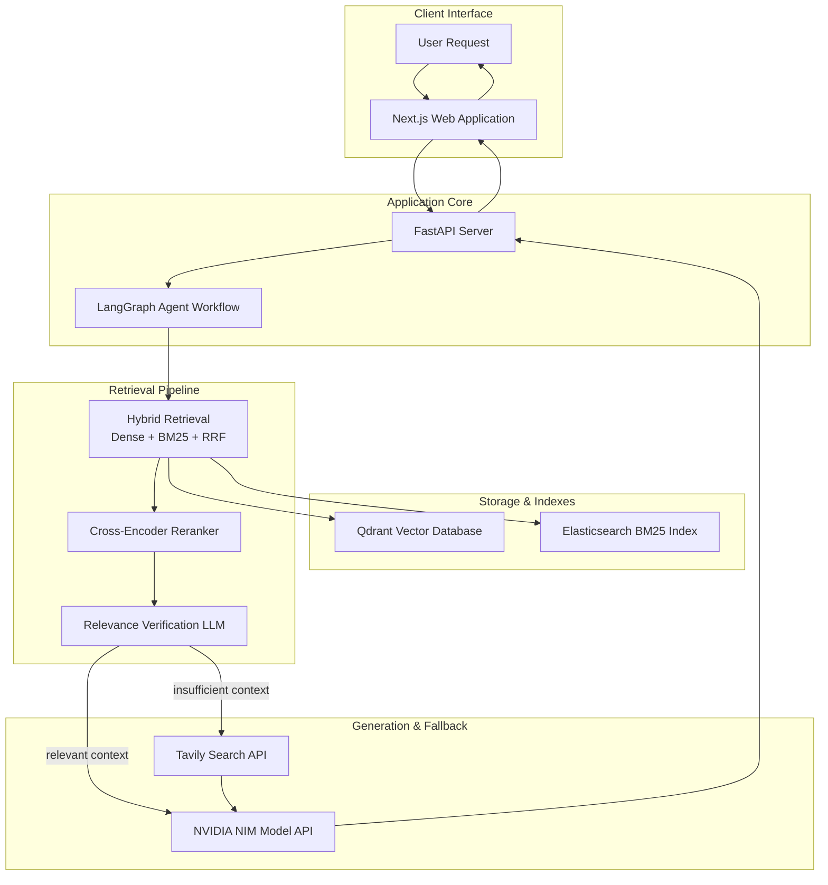

# Academic Research Assistant

Agentic RAG platform for querying and synthesizing insights from arXiv machine learning research papers using hybrid vector-lexical retrieval and ReAct agent workflows.

---

## System Architecture

### Architectural Overview



---

## Agent Routing & Pipeline Flow

The agent pipeline routes incoming queries through an execution graph:

1. **Query Router**: Classifies incoming query intent (`direct_answer`, `reject`, `clarify`, `process`).
2. **Hybrid Search**: For research questions, queries Qdrant (dense semantic embeddings) and Elasticsearch (BM25 keyword search), fusing candidates via Reciprocal Rank Fusion (RRF) and Cross-Encoder reranking.
3. **Relevance Judge**: Verifies whether retrieved context satisfies the question.
4. **Fallback Engine**: If local paper excerpts are insufficient or query involves recent news, executes web search via Tavily.
5. **Answer Synthesizer**: Generates the final grounded response referencing specific paper sources.

---

## Directory Structure

```
.
|-- backend/
|   |-- app.py                  # FastAPI application entrypoint
|   |-- contracts.py            # Pydantic schemas and API contracts
|   |-- dependencies.py         # Request-scoped workflow dependency injection
|   |-- graph/
|   |   |-- context.py          # State dictionary schema
|   |   |-- pipeline.py         # LangGraph workflow orchestration
|   |   `-- nodes/
|   |       |-- router.py       # Query intent classification
|   |       |-- knowledge_lookup.py # Hybrid search caller
|   |       |-- judge.py        # Relevance evaluation node
|   |       |-- live_web.py     # External search fallback
|   |       `-- writer.py       # Grounded answer generation
|   |-- retrieval/
|   |   `-- ranker.py           # Qdrant + ES + RRF + Cross-Encoder