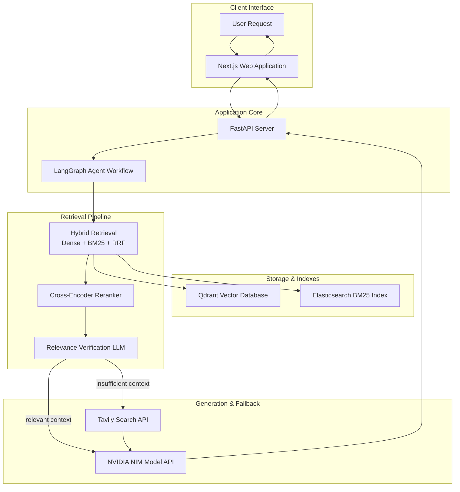

# Academic Research Assistant

Agentic RAG platform for querying and synthesizing insights from arXiv machine learning research papers using hybrid vector-lexical retrieval and ReAct agent workflows.

---

## System Architecture

### Architectural Overview



---

## Agent Routing & Pipeline Flow

The agent pipeline routes incoming queries through an execution graph:

1. **Query Router**: Classifies incoming query intent (`direct_answer`, `reject`, `clarify`, `process`).
2. **Hybrid Search**: For research questions, queries Qdrant (dense semantic embeddings) and Elasticsearch (BM25 keyword search), fusing candidates via Reciprocal Rank Fusion (RRF) and Cross-Encoder reranking.
3. **Relevance Judge**: Verifies whether retrieved context satisfies the question.
4. **Fallback Engine**: If local paper excerpts are insufficient or query involves recent news, executes web search via Tavily.
5. **Answer Synthesizer**: Generates the final grounded response referencing specific paper sources.

---

## Directory Structure

```
.
|-- backend/
|   |-- app.py                  # FastAPI application entrypoint
|   |-- contracts.py            # Pydantic schemas and API contracts
|   |-- dependencies.py         # Request-scoped workflow dependency injection
|   |-- graph/
|   |   |-- context.py          # State dictionary schema
|   |   |-- pipeline.py         # LangGraph workflow orchestration
|   |   `-- nodes/
|   |       |-- router.py       # Query intent classification
|   |       |-- knowledge_lookup.py # Hybrid search caller
|   |       |-- judge.py        # Relevance evaluation node
|   |       |-- live_web.py     # External search fallback
|   |       `-- writer.py       # Grounded answer generation
|   |-- retrieval/
|   |   `-- ranker.py           # Qdrant + ES + RRF + Cross-Encoder
|   |-- settings/
|   |   |-- environment.py      # Dataclass environment configuration
|   |   |-- connections.py      # LLM, Qdrant, and ES client factories
|   |   |-- prompts.py          # System prompts and templates
|   |   `-- eval_config.py      # Evaluation thresholds
|   |-- pipeline/
|   |   `-- pdf_extractor.py    # PDF parsing and document chunking
|   `-- metrics/
|       `-- benchmark.py        # RAGAS evaluation metrics runner
|-- frontend/
|   |-- app/                    # Next.js app router
|   |-- components/chat/        # React interface components
|   |-- hooks/                  # Client conversation state hook
|   |-- services/               # HTTP client service
|   `-- types/                  # TypeScript interface declarations
|-- scripts/
|   |-- entrypoint.sh           # Docker initialization sequence
|   |-- fetch_papers.py         # Automated arXiv PDF downloader
|   |-- extract_corpus.py       # PDF batch text processor
|   |-- index_es.py             # Elasticsearch index setup and ingestion
|   `-- index_qdrant.py         # Qdrant collection setup and vector upsert
|-- tests/                      # Pytest unit tests and evaluation suite
|-- docker-compose.yml          # Container configuration
|-- Dockerfile                  # Backend build definition
|-- requirements.txt            # Python dependencies
`-- pyproject.toml              # Build tool specifications
```

---

## Getting Started

### Prerequisites

- Docker and Docker Compose
- Or Python 3.11+ and Node.js 18+

### Environment Setup

Create `.env` based on `.env.example`:

```bash
cp .env.example .env
```

Set your NVIDIA NIM API key:

```env
NVIDIA_NIM_API_KEY=your_key_here
```

### Running with Docker Compose

```bash
docker compose up --build
```

The services will initialize:
- Backend API: `http://localhost:8000`
- API Documentation: `http://localhost:8000/docs`
- Frontend Web App: `http://localhost:3000`
- Elasticsearch: `http://localhost:9200`
- Qdrant Vector DB: `http://localhost:6333`

### Running Locally

#### 1. Backend Service

```bash
python -m pip install -r requirements.txt
uvicorn backend.app:app --host 0.0.0.0 --port 8000 --reload
```

#### 2. Frontend Application

```bash
cd frontend
npm install
npm run dev
```

---

## API Endpoints

- `POST /api/chat`: Process user queries with conversational context and streaming reasoning steps.
- `GET /api/health`: Health status probe for external monitoring.
- `GET /api/health/ready`: Readiness verification check.
- `GET /api/health/live`: Liveness verification check.


